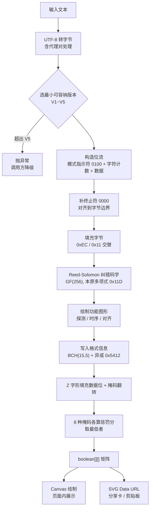

# 二维码分享：手写 QR 编码器实现与踩坑记录

> 适用范围：`apps/mobile/entry/src/main/ets/utils/QrCodeGenerator.ets`
> 回归工具：`apps/mobile/tools/qr-verify/verify_all.py`

## 背景

帖子详情页需要展示一个可扫描的二维码，扫码后通过深度链接
`maotuanzi://square/post/{id}` 直接拉起 App 打开对应帖子。

鸿蒙侧没有内置 QR 生成能力，且不希望为一个分享功能引入额外依赖或增加后端接口，
因此采用纯 ArkTS 手写编码器。

## 能力边界

| 版本 | 矩阵尺寸 | 字节模式容量（纠错级别 L） | 典型用途 |
|---|---|---|---|
| V1 | 21×21 | 17 字节 | 极短文本 |
| V2 | 25×25 | 32 字节 | **帖子深链主场景**（`maotuanzi://square/post/123` = 27 字节） |
| V3 | 29×29 | 53 字节 | 带查询参数的深链 |
| V4 | 33×33 | 78 字节 | — |
| V5 | 37×37 | 106 字节 | 上限 |

- 纠错级别固定为 L（约 7% 纠错能力），V1~V5 在 L 级下均为单纠错块，因此无需实现块交错逻辑。
- 容量数字已扣除 4 位模式指示符 + 8 位字符计数指示符的开销。
  这里曾算错：误把 V4/V5 的**数据码字数** 80/108 直接当成字节容量，实际应为 78/106。
- 超出 V5 容量会抛异常，调用方需捕获并降级（当前 `PostDetail.ets` 降级为不展示二维码）。
- 中文与 Emoji 均支持（UTF-8 编码，含代理对处理）。

## 编码流程



## 三个"错了也不报错"的坑

这类 bug 的共同特征：**生成的图形看起来完全正常** —— 三个定位角、对齐图案、静区都在，
排版也对，但扫码器解不出任何内容（返回空串）。肉眼比对和常规单元测试都发现不了。

### 坑 1：格式信息的行列方向写反（影响最大）

15 位格式信息有两份副本。第一份环绕左上探测图形，走向是**先竖后横**：

| 位 | 位置 | 方向 |
|---|---|---|
| bit0 ~ bit5 | 第 8 **列**，行 0~5 | 竖直，自上而下 |
| bit6 | 行 7，第 8 列 | 跳过时序行 6 |
| bit7 | 行 8，第 8 列 | 拐角 |
| bit8 | 行 8，第 7 列 | 折入水平方向 |
| bit9 ~ bit14 | 第 8 **行**，列 5~0 | 水平，自右向左 |

最初写成了完全转置的版本（`m[8][i]` 而非 `m[i][8]`）。
参考实现里这类函数常写作 `setFunctionModule(x, y, ...)`，即**先列后行**，
照抄时若按 `(row, col)` 理解就会整体转置。

转置后 15 位中有 7 位恰好落在对称位置上（值相同），只有 8 位不同 ——
更容易让人误判为"接近正确、只差一点"，实际扫码器完全无法读取版本与掩码信息。

### 坑 2：数据填充的列组方向依赖了组内偏移

数据位按每两列一组、自右向左、蛇形填充，**组内两列共用同一垂直方向**，
方向仅由列组决定，逐组上下交替：

```ts
const upward: boolean = (((col + 1) & 2) === 0)   // 正确：只看列组
// 错误写法：const upward = ((col + dc) % 2 === 0) —— 依赖组内偏移 dc，
// 会导致同一组的左右两列方向相反，数据位顺序整体错乱
```

### 坑 3：掩码判定极性反转

ISO/IEC 18004 表 10 定义的 8 个掩码条件，判定式一律是 `=== 0`
（即公式取模结果为 0 时，翻转该模块）：

```ts
case 0: return (r + c) % 2 === 0     // 正确
// 写成 === 1 等于把掩码整体取反，约半数数据模块出错
```

排查过程中曾**误把正确的 `=== 0` 改成 `=== 1`**，反而引入了新问题。
教训：不要凭直觉调整这类标准常量，应以真实解码结果为唯一判据。

### 附加问题：SVG viewBox 单位不匹配

`viewBox` 用的是模块数（`total`），但 `<rect>` 坐标乘了 `cell` 像素，
两者单位不一致，会导致渲染出的图形只有左上一小块。已统一为像素单位。

## 渲染方式：为什么用 Canvas 而不是 ForEach

最初用嵌套 `ForEach` 逐模块渲染 `Column`，组件数量随版本急剧膨胀：

| 版本 | 模块数 | ForEach 方案组件数 | Canvas 方案组件数 |
|---|---|---|---|
| V1 | 21×21 | 441 | 1 |
| V2 | 25×25 | 625 | 1 |
| V3 | 29×29 | 841 | 1 |
| V5 | 37×37 | 1369 | 1 |

已改为单个 `Canvas` + `fillRect` 绘制。

模块边长 `cell` 取 `max(3, 120 / total)`，保证单模块不低于 3vp ——
在 2.0x~3.5x 屏幕密度下对应 6~10 物理像素，实测各版本均可正常识别。

## 验证方法

**只有真实解码能作为判据。** 手工比对矩阵、检查中间值都不可靠
（排查中曾出现"格式位与权威值完全一致、RS 生成多项式完全正确，但依然扫不出"的情况）。

回归工具 `apps/mobile/tools/qr-verify/verify_all.py` 直接读取 ArkTS 源文件
（通过 Node 类型剥离运行），用 OpenCV `QRCodeDetector` 解码，分四个阶段共 48 项检查：

| 阶段 | 对象 | 项数 |
|---|---|---|
| A | `encode()` 矩阵层，V1~V5 边界 / 中文 / Emoji / 超容量保护 | 15 |
| B | `matrixToSvgDataUrl()` SVG 层，含 viewBox 单位校验 | 9 |
| C | Canvas 绘制参数 @ 2.0x~3.5x 屏幕密度 | 20 |
| D | 与 Python `qrcode` 库交叉对照版本选择 | 4 |

当前状态：**48 PASS / 0 FAIL**。

一个有用的中间信号：与参考库逐位比对时，如果差异集中在第 8 行/列，
说明数据区和纠错都对，问题只在格式信息；如果差异散布全图，则是数据填充或掩码环节出错。

## 修改须知

`QrCodeGenerator.ets` 中三个易错点已用 `⚠️ 易错点` 注释标注。
改动该文件后请务必执行：

```bash
cd apps/mobile/tools/qr-verify
python verify_all.py
```

## 相关文件

| 文件 | 职责 |
|---|---|
| `entry/src/main/ets/utils/QrCodeGenerator.ets` | QR 编码器 |
| `entry/src/main/ets/utils/ShareSheet.ets` | 深链拼装 + 系统分享面板 |
| `entry/src/main/ets/pages/square/PostDetail.ets` | 二维码 Canvas 渲染 + 分享入口 |
| `tools/qr-verify/verify_all.py` | 扫码正确性回归 |
