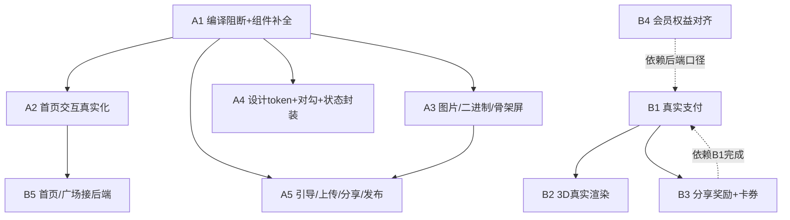

# 毛团子AI · 鸿蒙端「落地质量 + 商业化」优化方案

> 评审人：高见远（架构师）｜对象：鸿蒙端 `apps/mobile`（HarmonyOS ArkTS + ArkUI，API 12）
> 评审方式：全量走查主理人确证问题 + 补充阅读 40+ 源文件 + 设计文档（`docs/设计/*`）
> 范围：仅评审与方案，**未修改任何源码**
> 结论：应用「外观完整、内核多处是 Demo」——多数工具/广场/宠物/订单页已接真实后端；但**支付、3D、分享奖励、部分首页交互、若干组件/图片二进制**是假的或坏的，且存在**编译阻断级**缺口。

---

## 〇、主理人 15 条确证问题 · 复核结论

| # | 问题 | 复核结果 | 关键证据 |
|---|------|---------|----------|
| 1 | OrderDetail.onPay 是模拟支付 | ✅ 仍存在 | `me/OrderDetail.ets:34-40` setTimeout 1500ms 弹"支付成功（模拟）"，无微信/华为支付调用 |
| 2 | Model3D 是 3D 占位页，付费/渲染均未落地 | ✅ 仍存在 | `ai/Model3D.ets:113-141` 仅渐变圆 + 旋转；`UnlockDialog:58-61` "支付功能开发中" |
| 3 | Result.onShare 分享得券是假的 | ✅ 仍存在 | `ai/Result.ets:98-126` 无论成败都弹"获得1次券"，且用 `ApiService.me()` 伪记录；`ApiService` 无 `recordShare` |
| 4 | Vip.onPurchase→OrderDetail 假支付 | ✅ 仍存在 | `me/Vip.ets:96-104` createOrder 后跳 OrderDetail，而 OrderDetail 支付为模拟（见#1） |
| 5 | Toast.show 是空实现 | ✅ 仍存在 | `components/CommonComponents.ets:196-201` 仅 `console.log` |
| 6 | 首页 Banner 指示器不跟随 | ✅ 仍存在 | `home/Index.ets:77,130-154` `currentBanner` 声明但 Swiper 无 `.onChange()` 更新 |
| 7 | 首页"推荐/最新"Tab 假交互 | ✅ 仍存在 | `home/Index.ets:78,264-285` activeTab 切换只动下划线，WORKS 硬编码不变 |
| 8 | 首页 BANNERS/WORKS 硬编码 mock | ✅ 仍存在 | `home/Index.ets:25-71` Unsplash 写死，未接 listPosts/listWorks/activities |
| 9 | RemoteImage 字符串高度占位跳变 | ✅ 仍存在 | `components/CommonComponents.ets:475,490` height 为 string 时占位固定 120px |
| 10 | SkeletonBlock 定时器不清理 | ✅ 仍存在 | `components/CommonComponents.ets:322-327` setInterval 无 aboutToDisappear 清理 |
| 11 | Result.onSave 二进制损坏 | ✅ 仍存在 | `ai/Result.ets:41-96` `stringToArrayBuffer(charCodeAt)` + 未设 `ResponseType.ARRAY_BUFFER` |
| 12 | OrderDetail 对勾负 margin 脆弱 | ✅ 仍存在 | `me/OrderDetail.ets:116-137` `Text("✓").margin({top:-72})` 负偏移叠层 |
| 13 | 多处硬编码色未走设计 token | ✅ 仍存在（且更严重） | 见 §二 统计：`#FAAD14/#FF4D4F/#CCCCCC/#874D00/#FF6B6B/#07C160` 等散落 20+ 处 |
| 14 | Vip 权益表与 PRD 口径不一致 | ✅ 仍存在（且内部自相矛盾） | `me/Vip.ets:19-26` quarter "15张/月" vs PRD 季卡每月1次3D；`me/Index.ets:108` 却写"每月5张" |
| 15 | 缺统一返回/错误/空态封装 | ✅ 仍存在 | 各页 try/catch 文案各异（"加载失败，请重试"/"展示示例"…），无共享封装 |

**15 条全部在最新代码中仍然存在。** 此外补充发现 **8 项新缺口（S1–S8）**，其中 S1/S8 为编译阻断级。

---

## 一、诊断报告（P0 / P1 / P2）

> 每条含：`文件:行号` + 现象 + 用户影响 + 修复方向

### 🔴 P0 — 阻断级（不修无法商用 / 无法编译）

**P0-1 公共组件 `Tag` / `PriceTag` 未定义却被引用（编译阻断）**
- 位置：`me/OrderList.ets:6,51`、`ai/StyleSelect.ets:7,89,92`、`me/Works.ets:7`、`me/Index.ets:8`
- 现象：`OrderList.ets` 与 `StyleSelect.ets` 实际渲染了 `Tag({...})` / `PriceTag({...})`，但全仓 grep 确认 `CommonComponents.ets`（及全部源码）**未定义/未导出** `Tag`、`PriceTag`。`Works.ets`、`me/Index.ets` 仅 import 未使用。
- 用户影响：ArkTS 严格模式下未定义符号引用 = 编译错误；未使用 import 触发 `arkts-no-unused-imports`。**当前仓库大概率无法 `hvigor` 编译通过**，这正是"落地差"的根因之一。
- 修复方向（二选一，建议前者）：① 在 `CommonComponents.ets` 实现 `Tag`（类型 normal/warning/success/danger/info → 对应功能色背景）+ `PriceTag`（价格标签，毛团粉底白字）；② 或删除 `OrderList/StyleSelect` 中的 `Tag/PriceTag` 用法改用现有组件。（A1）

**P0-2 上传页未调起真实相册/相机，自动填充假图（AI 输入是假的）**
- 位置：`ai/Upload.ets:160-179`
- 现象：拍照/相册按钮 `onClick` 仅 `toast("请选择毛孩子照片")` 并把 `imageUrl` 写死为 Unsplash 图；未使用 `picker.PhotoViewPicker` / 相机。
- 用户影响：用户"上传"的其实是固定网图，AI 生成基于别人的猫 → **核心创作链路从输入起就是假的**，且离线/无网时图裂。
- 修复方向：用 `photoAccessHelper` / `cameraPicker` 真选图并 `ApiService.uploadImage` 拿到 `inputImageUrl` 再建任务。（A5 / 依赖后端上传通道）

**P0-3 支付全链路为模拟（会员 + 单次解锁 + 3D 全假的）**
- 位置：`me/OrderDetail.ets:34-40`、`me/Vip.ets:96-104`、`ai/Preview.ets:148-159`、`ai/Model3D.ets:58-61`
- 现象：所有"去支付"都 `setTimeout` 假成功；`ApiService` 无 `payOrder`；`Model3D` 直接"开发中"。
- 用户影响：**收不到一分钱**，商业项目不成立。
- 修复方向：接真实支付（微信支付鸿蒙 SDK / 华为 IAP），以后端回调为唯一成功标志（见 §三、B1）。

### 🟠 P1 — 严重（假交互 / 数据损坏 / 功能残缺）

**P1-1 首页 Banner 指示器与 Tab 是假交互**
- 位置：`home/Index.ets:77,130-154,264-285`
- 现象：`currentBanner` 从不更新 → 自定义圆点永远停在第 1 个；`activeTab` 切"最新"只动下划线，WORKS 不变。
- 用户影响：轮播看着在动、指示点不动；点"最新"毫无内容变化 → 用户觉得"坏了"。
- 修复方向：Swiper 加 `.onChange(idx=>currentBanner=idx)`；Tab 切换驱动 WORKS 过滤或显示真实加载态（A2）。

**P1-2 保存到相册的图片是损坏文件**
- 位置：`ai/Result.ets:41-96`
- 现象：`charCodeAt` 把二进制当字符串 → `Uint8Array` 被截断/乱码；且 `http.request` 未设 `ResponseType.ARRAY_BUFFER`，`HttpClient` 默认 `JSON.parse` 也会失败。
- 用户影响：相册里是打不开的坏图，用户以为"APP 生成质量差"。
- 修复方向：新增 `HttpClient.download` 设 `responseType: http.ResponseType.ARRAY_BUFFER`，用 `ArrayBuffer` 直写（A3）。

**P1-3 骨架屏定时器不清理 → 内存/定时器泄漏**
- 位置：`components/CommonComponents.ets:322-327`（`SkeletonBlock`）
- 现象：`aboutToAppear` 起 `setInterval`，无 `aboutToDisappear` 清理；列表多骨架时泄漏叠加。
- 用户影响：长时间使用后卡顿、电量异常。
- 修复方向：`aboutToDisappear` 中 `clearInterval`（A3）。

**P1-4 AI 创作页 3D/表情包/卡片/文案 Tab 是假 Tab**
- 位置：`ai/Index.ets:39-43,138-184`
- 现象：5 个 Tab 仅切换 `selectedTab` 本地态，下方风格列表恒为同一套 2D 列表，无独立内容/路由。
- 用户影响：点"3D手办/表情包"无专属内容 → 与 PRD/视觉规范 §4.2（每 Tab 独立网格）不符。
- 修复方向：各 Tab 路由到对应能力页或加载对应 `listStyles(category)`；暂不做的需诚实隐藏/置灰（A2 / B 能力补齐）。

**P1-5 分享二维码用 `localhost:8080` 硬编码（真机不可用），且已有 QR 生成器被弃用**
- 位置：`square/PostDetail.ets:131`、`utils/QrCodeGenerator.ets`（完整实现但无引用）
- 现象：分享卡二维码 URL 写死 `http://localhost:8080/v1/qrcode?...`；而项目自带完整 ArkTS `QrCodeEncoder`（V1–V5、RS 纠错、SVG DataURL）从未被使用。
- 用户影响：真机/模拟器扫码打不开；浪费了已写好的本地生成能力。
- 修复方向：改用 `QrCodeEncoder` 本地生成 `maotuanzi://square/post/{id}` 二维码（A5）。

**P1-6 引导期"创建宠物"不落库（TODO）**
- 位置：`onboarding/FirstPetGuide.ets:188-201`（`savePet` 注释 `// TODO: 调用 API`）
- 现象：只 toast "创建成功" 并置 `hasCreatedPet` 标志，未调 `ApiService.createPet`。
- 用户影响：首次引导建宠物后，列表为空，AI 上传仍提示"请先创建宠物档案"，体验断裂。
- 修复方向：调 `ApiService.createPet`（与 `tools/PetEdit.ets` 真实保存对齐）（A5）。

**P1-7 `Result.ets` 在 struct 体内声明独立 `function`（疑似 ArkTS 语法错误）**
- 位置：`ai/Result.ets:90-96`（`function stringToArrayBuffer(...)` 位于 struct 内）
- 现象：ArkTS 不允许在 struct 内声明游离 `function`（仅允许方法）。连同 P0-1 的 Tag，提示当前工程**编译状态存疑**，需主理人确认本仓库是否可编译（见 §五 待明确-7）。
- 修复方向：改为 struct 方法或提到文件顶层；与 A1 一并处理。

### 🟡 P2 — 一般（一致性 / 不完整 / 死代码）

**P2-1 设计 token 散落硬编码（一致性）** — 见 §二。
**P2-2 会员权益文案内部矛盾 + 与 PRD 不符** — `me/Vip.ets:19-26` vs `me/Index.ets:108`（B4）。
**P2-3 广场发帖不能附图** — `square/PostCreate.ets` 仅 `TextInput`，无图片选择；而 `PostDetail` 期望 `imageUrls`（P2-5）。
**P2-4 `Splash.ets` 为不可达死代码** — `EntryAbility.ets:42-44` 直接 load `OnboardingPage`/`pages/Index`，Splash 无入口（可删或接入冷启动）。
**P2-5 卡券中心 / 通知中心 为静态空态** — `me/Coupons.ets`、`me/Notifications.ets` 无 API（依赖 B3）。
**P2-6 设置-健康提醒订阅 / 数据导出为 TODO/假** — `me/Settings.ets:56-59,73`（鸿蒙无微信订阅消息，需系统通知替代）。
**P2-7 多处"保存/分享"按钮假反馈** — `ai/Preview.ets:133-134` "保存到作品"仅 toast；`me/OrderDetail.ets:182-204` 成功页"保存到相册/分享得免费券"仅 toast（依赖 A3/B3）。
**P2-8 文案未完全遵循品牌规范** — 视觉规范要求"用毛孩子代替宠物"，但多页用"宠物/养宠"（Tools/Symptom 等）；部分 emoji 用作图标（Onboarding/AiTab/PetEdit）。

---

## 二、UI/UX 问题清单（对照视觉规范 + 可访问性/一致性/动效）

> 基线：`docs/设计/UIUX视觉规范与组件库.md`。注意：**该文档本身是微信小程序版（rpx / iPhone 14 / three.js-miniprogram）**，与鸿蒙 ArkUI（vp）存在平台差异——颜色/圆角/间距 token 可复用，布局与组件库需按 ArkUI 重对齐（见 §五-3）。

### 2.1 一致性（最普遍）
| 问题 | 散落位置 | 规范依据 | 修复 |
|------|---------|---------|------|
| 功能色硬编码未走 `Colors` | `#FAAD14`：Vip:134、Tools/Index:68、Symptom:171、FeedingPlan:213、me/Index:63/66、Model3D；`#FF4D4F`：多处；`#CCCCCC`：me/Index:197、PetList:76；`#874D00` 免责文案：MedicalDisclaimer、Upload、Tools/Index、Symptom；`#FF6B6B/#4ECDC4/#FFD93D`：home/Index:313；`#07C160`：Login、ShareSheet | §2.3 功能色表 | 全局替换为 `Colors.WARNING/ERROR/...`；免责黄用 `Colors.WARNING`+新 `TEXT_WARNING` token |
| 价格/会员标签未用规范组件 | OrderList/StyleSelect 用 `Tag`/`PriceTag`（且缺失）；规范 §3.4 定义价格标签=毛团粉底白字 | §3.4 | 实现并统一 |
| 同一页多主按钮 | Vip/Preview/OrderDetail 等主+次按钮并存（规范 §3.1"同页最多1主按钮"） | §3.1 | 评估，次要操作降级次按钮/文字按钮 |
| 圆角/间距偶发不符 | 多处手写 `radius:8/12` 未统一；按钮高度偶发非 48 | §2.5/§3.1 | 走 `Radius` token |

### 2.2 可访问性 / 适配
- **安全区缺失**：底部 FAB（`square/Index.ets:209`）、固定按钮未加 `safeArea`/底部 padding，刘海/手势条机型可能遮挡（规范 §九 要求底部安全区）。
- **图片变形风险**：`home/Index.ets` workCard 用 `aspectRatio(1)` + `Cover`，竖图会被裁；规范 §7.3 要求 `aspectFill/Fit` 避免变形——需按内容选择。
- **对比度**：`#CCCCCC` 次级图标/chevron 在白底对比偏弱（规范弱文字 `#999`）；免责 `#874D00` 在 `#FFF7E6` 上可读但非 token。
- **动效原则**：规范 §八 要求"动效为反馈非炫技、低端机减动效"。当前 `animateTo` 普遍合规，但 `Model3D` 每秒 `setInterval` 强制旋转无降级；`SkeletonBlock` 每 800ms 重排（P1-3）。

### 2.3 动效 / 交互细节
- **对勾动画脆弱**（P0 区 #12）：`OrderDetail.ets` 负 margin 叠层，应改 `Stack` 叠放（A4）。
- **指示器跳变**（P1-1）：Banner 圆点不跟随（A2）。
- **空/错误态不统一**（#15）：`EmptyState` 已存在但用法不一——`Coupons/Notifications` 永远空态；`Square/Works/OrderList` 条件使用；错误文案各写各的。建议抽 `UiState` 包装（A4）。

---

## 三、商业化落地差距清单（对接约束）

### 3.1 真实支付接入
- **差距**：`OrderDetail.onPay` / `Vip.onPurchase` / `Preview.onUnlock` / `Model3D` 全部模拟；`ApiService` 缺 `payOrder`。
- **对接约束**：
  - **方案 A 微信支付（鸿蒙）**：需开通微信支付商户号 + 鸿蒙端 `wechat-open-sdk`（`@ohos/wechat`（若官方提供）或 通过 `ability` 拉起微信）；拿到 `prepay_id` 后调 `pay`。**注意**：鸿蒙微信支付 SDK 成熟度/资质需确认。
  - **方案 B 华为 IAP（In-App Purchases）**：鸿蒙原生、结算走华为，需上架华为应用市场并配置商品（消耗型/非消耗型/订阅）；适合会员订阅。抽成与结算周期不同。
  - **强约束（来自 `状态机与业务规则汇总.md` §8.4）**：**微信支付回调是唯一可靠成功标志，禁止前端自判成功；支付成功用 `wx_transaction_id` 幂等发权益**。后端 `/v1/orders/{id}/pay` 应返回调起参数，前端仅负责拉起 + 轮询订单状态（已有 `getOrder`，且 `HttpClient` 已处理 `102001/102002` 过期）。
- **推荐**：会员订阅优先华为 IAP（原生体验+订阅管理能力），单次解锁/画像可微信支付；或统一微信支付（需评估鸿蒙可用性）。**需主理人拍板（§五-1）**。

### 3.2 3D 真实渲染架构
- **差距**：`Model3D.ets` 为渐变占位；PRD 要求单图生成 360° 可交互模型 + 材质/背景/动作切换 + 拍照导出。
- **方案对比**：
  | 方案 | 说明 | 优劣 | 依赖 |
  |------|------|------|------|
  | XComponent + 原生 3D 引擎 | `XComponent`(C++/ArkTS) 接 glTF 加载器（如 filament/tinygltf 自研封装） | 性能最佳、可 `preserveDrawingBuffer` 截图；开发成本高、包体大 | 后端返回 `.glb/.gltf` + 自研/三方渲染模块 |
  | **Web 组件内嵌 Three.js** | `Web({src})` 加载本地 H5（打包 three.js），通过 `Java/TS` 桥接参数 | 复用 `UIUX视觉规范 §六` 现有 three.js 方案思路；开发快、跨端；性能/内存弱于原生 | 后端返回模型文件 URL 或参数；H5 资源打包 |
  | 后端渲染图序列/视频 | 后端出 360° 帧序列，前端帧动画 | 最简单；非真交互 | 后端算力 |
- **约束**：模型由谁生成与托管未定（§五-2）；`状态机`未定义 3D 任务，需在后端新增 3D 生成任务 + 文件托管（OSS）。导出 PNG 需 `preserveDrawingBuffer`（规范 §六）。
- **推荐**：MVP 用 **Web+Three.js**（快速验证体验），规模期迁 XComponent。

### 3.3 分享奖励真实化
- **差距**：`Result.onShare`/`OrderDetail` 分享按钮无论成败都发券（假）；`ApiService` 无 `recordShare`；`Coupons` 静态空。
- **对接约束**：
  - 鸿蒙**系统分享面板（华为分享）无"分享成功"回调**，无法判定用户是否真分享 → 不能简单"一点就发券"（会被刷）。
  - 可行归因：① 应用内生成分享卡（含深度链接 `maotuanzi://`）+ 后端统计"被点击/被打开"后发券；② 仅对"复制链接"这种可确认动作发券；③ 接入华为分享的 `getShareResult`（如有）。
  - 需后端新增 `POST /v1/shares/record`、`GET /v1/coupons`、`POST /v1/coupons/grant(share)`。
- **顺带**：`PostDetail` 二维码应改用本地 `QrCodeGenerator`（P1-5），深度链接 `maotuanzi://square/post/{id}` 已被 `EntryAbility` 解析支持。

### 3.4 会员权益口径一致性
- **差距**：`Vip.ets` 权益表（季卡"15张/月"、年卡"50张/月"、3D"季卡每月1次/年卡每月3次"）与 PRD（月卡5张高清/季卡每月1次3D/年卡每月2次3D）不符；`me/Index.ets:108` 又写"每月5张"——**三处口径互不一致**；`free:"0张"` 与 PRD"免费可看预览"矛盾。
- **对接约束**：权益是**商业定价核心**，必须以 PRD/后端 `listProducts` 返回为准（当前 `Vip.loadProducts` 已尝试读后端，失败才降级 `DEFAULT_PRODUCTS`/`BENEFITS`）。应让 `BENEFITS` 完全由后端驱动或严格对齐最终 PRD 口径；FAQ"支持微信、支付宝"在鸿蒙需改为"微信/华为支付"（§五-4）。

---

## 四、优化任务列表

> 分组：**A 类=可立即实施（纯前端，无后端/外部资源依赖）**；**B 类=需后端/资源/SDK 配合**。
> 每条含：目标文件 + 依赖 + 验收标准。任务依赖图见 §4.3。

### 4.1 A 类（可立即实施）

**A1 · 编译阻断修复 + 公共组件补全**
- 目标文件：`components/CommonComponents.ets`（实现 `Tag`/`PriceTag`）、`ai/Result.ets`（P1-7 `function` 外提/改方法）、`me/OrderList.ets`、`ai/StyleSelect.ets`、`me/Index.ets`、`me/Works.ets`（清理/改用）
- 依赖：无
- 验收：`hvigor assembleHap` 编译通过；`Tag`/`PriceTag` 正常渲染；`Toast.show` 真实弹出（见 A4）

**A2 · 首页交互真实化（指示器/Tab/表情包等 Tab 诚实处理）**
- 目标文件：`pages/home/Index.ets`（Swiper `.onChange`→`currentBanner`；`activeTab` 切换驱动 WORKS 过滤或真实加载态；3D/表情包等 Tab 路由或隐藏）
- 依赖：A1（编译通过）
- 验收：轮播指示点跟随；切 Tab 有真实内容变化或"加载中"而非假死；无硬编码 Unsplash（接后端见 B5）

**A3 · 图片/二进制/骨架屏修复**
- 目标文件：`components/CommonComponents.ets`（`RemoteImage` 字符串高度占位尺寸一致；`SkeletonBlock` `aboutToDisappear` 清定时器）、`ai/Result.ets`（`onSave` 改用 `HttpClient.download` + `ARRAY_BUFFER` 真二进制）、`service/HttpClient.ets`（新增 `download` 方法设 `responseType`）
- 依赖：A1
- 验收：相册保存的图可正常打开；列表页退出后无残留 `setInterval`；加载/失败占位尺寸与真实图一致

**A4 · 设计 token 统一 + 对勾动画 + 统一状态封装**
- 目标文件：新增 `utils/UiState.ets`（loading/empty/error 包装 + 统一文案常量，落地 #15）；`me/OrderDetail.ets`（对勾改 `Stack` 叠层，#12）；全局替换硬编码功能色为 `Colors`（Vip/Tools/Index/Symptom/FeedingPlan/me/Index/home/Index/Model3D/Reminders 等）；`common/Colors.ets`（按需补 `TEXT_WARNING` 等 token）
- 依赖：A1
- 验收：全仓无散落 `#FAAD14/#FF4D4F/#CCCCCC/#874D00/#FF6B6B/#07C160` 等（除必要品牌绿）；对勾不错位；各页错误/空态文案一致

**A5 · 引导/上传/分享/发布小修**
- 目标文件：`onboarding/FirstPetGuide.ets`（`savePet` 调 `ApiService.createPet`）、`ai/Upload.ets`（调起 `photoAccessHelper`/`cameraPicker` 真选图 + `uploadImage`）、`square/PostDetail.ets`（用 `QrCodeGenerator` 替代 localhost）、`square/PostCreate.ets`（支持附图 `picker`+`uploadImage`+`publishPost` 带 `imageUrls`）
- 依赖：A1、A3（`uploadImage` 通道）；PostCreate 附图依赖后端发帖支持图（B5 顺带）
- 验收：引导能建真实宠物；上传选的是用户真照片（非 Unsplash）；分享二维码真机可扫；发帖可带图

### 4.2 B 类（需后端 / 资源 / SDK）

**B1 · 真实支付接入（微信支付 / 华为 IAP）**  ★商业化核心
- 目标文件：`me/OrderDetail.ets`（`onPay` 调 `payOrder`→拉起 SDK→轮询 `getOrder`）、`service/ApiService.ets`（增 `payOrder(id)`）、新增 `utils/Payment.ets`（封装微信/华为调起）、`me/Vip.ets`/`ai/Preview.ets`/`ai/Model3D.ets`（统一走支付）
- 依赖：主理人决策支付方式（§五-1）；商户号/证书/SDK；后端 `/v1/orders/{id}/pay` 与回调
- 验收：真机调起支付；支付成功订单状态→已支付；权益幂等发放（`wx_transaction_id` 去重）；失败可重试

**B2 · 3D 真实渲染与模型加载**  ★旗舰差异能力
- 目标文件：`ai/Model3D.ets`（替换渐变占位为真实渲染）、新增 `3d/` 渲染模块（XComponent 或 Web+Three.js）、`ai/UnlockDialog`（解锁接 B1 支付）
- 依赖：B1（解锁/导出付费）；后端 3D 生成任务 + 模型文件托管（§五-2）；渲染方案选型（§五-2）
- 验收：单图生成 360° 可交互模型；材质/背景/动作切换；拍照导出 PNG

**B3 · 分享奖励真实化 + 卡券中心**
- 目标文件：`service/ApiService.ets`（增 `recordShare`/`listCoupons`/`grantShareCoupon`）、`ai/Result.ets`/`me/OrderDetail.ets`/`square/PostDetail.ets`（分享成功归因后端发券）、`me/Coupons.ets`（接 `listCoupons`）、`utils/ShareSheet.ets`（分享归因策略）
- 依赖：后端分享奖励接口；归因方案（§五-4）
- 验收：真实分享才发券（防刷）；卡券中心有真实数据

**B4 · 会员权益与套餐数据对齐后端**
- 目标文件：`me/Vip.ets`（权益表改为后端驱动/严格对齐 PRD）、`me/Index.ets`（VIP 文案与 Vip 一致）、`me/Vip.ets` FAQ 支付方式改写
- 依赖：后端权益口径；PRD 最终口径确认（§五-4）
- 验收：会员页/首页权益文案与 PRD/后端一致；free 权益与 PRD 一致

**B5 · 首页/广场内容接后端（数据真实化）**
- 目标文件：`pages/home/Index.ets`（BANNERS→`listActivities`、WORKS→`listWorks`/`listPosts`）、`service/ApiService.ets`（增 `listActivities`）、`square/PostCreate.ets`（发帖带图，依赖后端）
- 依赖：后端 activities/works 接口稳定；A2（前端已就位）
- 验收：首页 Banner/作品/广场为真实运营/用户数据；离线有降级占位而非 Unsplash 写死

### 4.3 任务依赖图

---

## 五、待明确事项（需主理人 / 用户拍板）

1. **鸿蒙端支付走微信支付还是华为 IAP？** 二者 SDK 资质、结算、订阅能力差异大；是否双通道？决定 B1 实现路径与后端 `/pay` 返回结构。
2. **3D 模型由谁生成、如何托管？** 后端出 `.glb` 文件 URL 还是参数化前端渲染？渲染选型 XComponent(原生) vs Web+Three.js（性能/包体/工期权衡）？决定 B2 架构。
3. **设计文档是微信小程序版（rpx/iPhone/three.js-miniprogram）**，鸿蒙端 vp 适配基线是否需重出？颜色/圆角/间距 token 可复用，但布局与"组件库选型"等未决项（文档 §十一）需按 ArkUI 重新落地。
4. **会员权益最终口径**：月卡/季卡/年卡 高清额度与 3D 次数以哪版为准（PRD vs `Vip.ets` vs `me/Index.ets` 三者矛盾）？free 是否可看预览？FAQ 支付方式鸿蒙下改写为"微信/华为"。
5. **分享奖励归因策略**：系统分享无成功回调，如何防刷发券？（应用内分享卡+后端点击归因 / 仅复制链接发券 / 华为分享结果 API）
6. **后端接口就绪度**：`payOrder` / `recordShare` / `listCoupons` / `listActivities` / 3D 生成任务 当前是否已具备？决定 B 类任务能否并行启动。
7. **编译状态确认**：当前仓库 `Tag/PriceTag` 缺失 + `Result.ets` 内 `function` 是否确为遗漏（即本仓库实际无法编译）？还是本地有未提交实现？需主理人确认，以便 A1 直接修复还是先对齐。
8. **素材与版权**：Banner/作品当前用 Unsplash，上线需替换为自有 CDN / 用户生成图，避免版权风险与离线失效（关联 B5）。

---

## 附：评审覆盖范围
- 已读：OrderDetail、Model3D、Result、CommonComponents、home/Index、Vip、Index(root)、ApiService、HttpClient、Constants、Colors、ai/{Index,Upload,Generating,Preview,StyleSelect}、square/{Index,PostCreate,PostDetail}、tools/{Index,Symptom,FeedingPlan,Reminders,PetList,PetEdit}、me/{Index,Works,Coupons,OrderList,Notifications,Settings}、onboarding/{OnboardingPage,FirstPetGuide}、auth/Login、common/{WebView}、Splash、utils/{ShareSheet,QrCodeGenerator}、EntryAbility、设计文档（UIUX视觉规范、状态机与业务规则、品牌与文案、接口错误码相关）。
- 确证主理人 15 条问题**全部仍存在**；补充发现 S1–S8（其中 P0-1/P0-2/P0-3 为商业化与编译阻断级）。
- 未修改任何源码；仅产出本方案文档。
